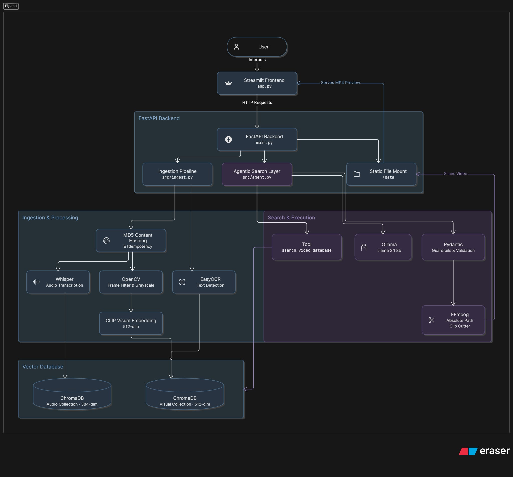
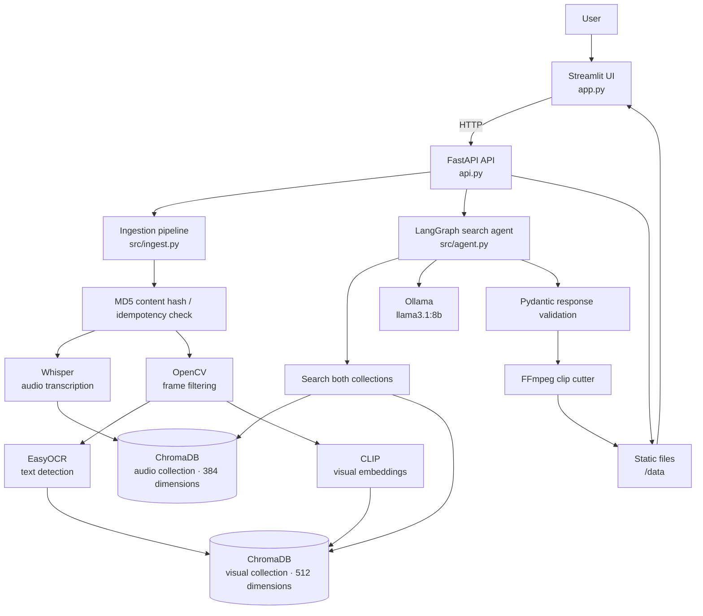

# CLIP-SEARCH : Multi-Modal Video Search Agent

Search a local video library with ordinary language and receive a playable clip
from the matching moment. The project indexes **what is said**, **what appears
on screen**, and **text visible in frames**, then uses a local LLM to validate
the retrieved evidence before cutting a result with FFmpeg.

It is designed to run locally: videos, embeddings, generated clips, and the
LLM all stay on the machine running the application.

## What it can do

- Ingest a local video file, uploaded file, or YouTube URL.
- Transcribe speech with Whisper and make transcript segments searchable.
- Detect meaningful visual changes, read on-screen text with EasyOCR, and
  index selected frames with CLIP embeddings.
- Search across audio and visual evidence with natural-language queries.
- Ask a local `llama3.1:8b` model through Ollama to validate whether the
  retrieved evidence is a genuine match.
- Create a buffered MP4 preview around a verified timestamp.
- Avoid duplicate work when the same local file or explicit video ID has
  already been indexed.

## Architecture



The diagram above is the visual reference architecture for the project. The
renderable diagram below presents the same flow in a format that is easy to
read directly on GitHub and in Markdown viewers.



### How a request flows

1. A video is added from a local path, browser upload, or YouTube URL.
2. The ingestion pipeline assigns an ID. Local files get a deterministic MD5
   based ID such as `vid_a1b2c3d4e5f6`; YouTube sources use `yt_<youtube-id>`.
3. Whisper splits speech into timestamped transcript segments. OpenCV samples
   roughly one frame per second and keeps only frames whose pixels changed
   enough from the prior kept frame. EasyOCR extracts visible words, and CLIP
   creates a visual embedding.
4. ChromaDB stores the timestamp, original file path, video ID, and embeddings
   in separate audio and visual collections.
5. A query produces a 384-dimensional text vector for transcript search and a
   512-dimensional CLIP text vector for visual search.
6. The LangGraph agent calls the search tool, then Ollama returns a structured
   result. Its guardrails instruct it to decline weak or invented matches.
7. For a verified match, FFmpeg creates an MP4 from two seconds before the
   match to two seconds after it. The UI plays it from FastAPI's `/data` mount.

## Prerequisites

Install these before starting:

- [Python 3.11+](https://www.python.org/downloads/) (the project is configured
  for Python 3.11).
- [FFmpeg](https://ffmpeg.org/download.html), available on your `PATH`.
- [Ollama](https://ollama.com/) with the model used by the agent:

  ```powershell
  ollama pull llama3.1:8b
  ```

- An internet connection the first time model packages download Whisper,
  SentenceTransformer/CLIP, and EasyOCR weights. After the initial download,
  their cached weights can be reused locally.

For YouTube ingestion, availability is subject to the source site's access
rules and `yt-dlp` support. Only download and process content you are allowed
to use.

## Setup

Run these commands from the repository root.

```powershell
# Create and activate a virtual environment
py -3.11 -m venv .venv
.\.venv\Scripts\Activate.ps1

# Install Python packages
python -m pip install --upgrade pip
pip install -r requirements.txt

# Create the application data directory if it does not already exist
New-Item -ItemType Directory -Force data | Out-Null
```

If you use [`uv`](https://docs.astral.sh/uv/), the equivalent dependency setup
is `uv sync`.

Confirm the two non-Python runtime dependencies before continuing:

```powershell
ffmpeg -version
ollama list
```

`ollama list` should include `llama3.1:8b`. Start the Ollama service if it is
not already running (`ollama serve` in a separate terminal on typical local
installations).

## Run the application

Use two terminals, both with the virtual environment activated.

**Terminal 1 — API**

```powershell
uvicorn api:app --host 127.0.0.1 --port 8000 --reload
```

**Terminal 2 — web UI**

```powershell
streamlit run app.py
```

Open the address Streamlit prints (normally `http://localhost:8501`). The API
is available at `http://127.0.0.1:8000`, and interactive API documentation is
at `http://127.0.0.1:8000/docs`.

### First search

1. In the Streamlit sidebar, select **Upload File** or **YouTube URL**.
2. Optionally provide a stable custom video ID; otherwise the system creates
   one automatically.
3. Wait for ingestion to finish. The first video can take a while because
   models may need to download and the audio/video are fully analyzed.
4. Enter a question such as `When does the speaker show code?` and select
   **Search & Cut Clip**.
5. If the agent has strong evidence, the UI shows the video ID, timestamp,
   reasoning, and an MP4 preview. A "no authentic match" response is an
   intentional guardrail outcome, not necessarily an application error.

## Command-line workflow

The CLI supports direct ingestion, querying, and evaluation.

```powershell
# Index a local video; omit the ID to use a content-derived ID
python main.py ingest .\data\sample.mp4 demo_video

# Index a YouTube video
python main.py ingest "https://www.youtube.com/watch?v=VIDEO_ID"

# Search and save a matching clip
python main.py query "When does the speaker discuss cross attention?"

# Run the included evaluation dataset
python main.py eval
```

## HTTP API

All endpoints are served by `api.py`.

| Method | Endpoint | Purpose |
| --- | --- | --- |
| `POST` | `/ingest-url` | Ingest a local path or a YouTube URL. |
| `POST` | `/upload-video` | Upload and ingest a multipart video file. |
| `POST` | `/search?query=...` | Search indexed content and optionally generate a clip. |
| `GET` | `/health` | Check ChromaDB connectivity and CUDA availability. |
| `GET` | `/data/<file>` | Serve original files and generated clips stored in `data/`. |

Example URL/local-path ingestion:

```powershell
Invoke-RestMethod -Method Post -Uri "http://127.0.0.1:8000/ingest-url" `
  -ContentType "application/json" `
  -Body '{"source":"https://www.youtube.com/watch?v=VIDEO_ID"}'
```

Example search:

```powershell
Invoke-RestMethod -Method Post `
  -Uri "http://127.0.0.1:8000/search?query=When%20does%20the%20speaker%20show%20code"
```

The search response follows this shape:

```json
{
  "found_match": true,
  "video_id": "yt_example",
  "start_time": 42.0,
  "end_time": 48.0,
  "reasoning": "The retrieved evidence directly supports the query.",
  "clip_path": "C:\\...\\data\\yt_example_clip_40_50.mp4"
}
```

## Project layout

```text
.
├── api.py                 # FastAPI service and static /data mount
├── app.py                 # Streamlit browser interface
├── main.py                # CLI: ingest, query, eval
├── src/
│   ├── ingest.py          # Download/hash/transcribe/frame/OCR/index pipeline
│   ├── agent.py           # LangGraph workflow, retrieval, validation, clipping
│   ├── db_client.py       # Persistent ChromaDB collections
│   ├── evaluate.py        # Evaluation metrics runner
│   ├── utils.py           # Generated-clip cleanup
│   └── logging_config.py  # Console and app.log logging
├── data/                  # Ignored runtime files: videos, clips, ChromaDB
├── eval_dataset.json      # Example positive and negative evaluation cases
├── requirements.txt       # pip dependency list
└── pyproject.toml         # Project metadata and uv dependency definition
```

## Data, caching, and cleanup

`data/` is intentionally excluded from Git. It contains original/uploaded
videos, downloaded YouTube files, ChromaDB's persistent index, and generated
clips. Back it up if you want to preserve an indexed library between machines.

The system checks the audio collection for an existing `video_id` before it
does costly inference. Re-ingesting the same local file without a custom ID
therefore skips duplicate encoding because its MD5-derived ID is unchanged.
Changing the content creates a new ID; providing your own ID makes you
responsible for keeping it unique.

Generated files whose names contain `_clip_` are cleaned up when the FastAPI
service starts if they are more than one hour old. Source videos are not part
of that cleanup rule.

## Evaluation

`eval_dataset.json` contains expected timestamps and negative queries. Run
`python main.py eval` after ingesting the videos referenced by that file. The
report logs three measures:

- retrieval accuracy for positive cases;
- timestamp accuracy within a five-second tolerance;
- guardrail accuracy for queries that should not match.

Evaluation relies on a generative local model, so exact results can vary by
model version, hardware, and indexed content.

## Troubleshooting

| Symptom | Likely cause and fix |
| --- | --- |
| `ffmpeg` is not recognized | Install FFmpeg and add its `bin` directory to `PATH`; reopen the terminal. |
| Ollama connection/model error | Run `ollama serve` and `ollama pull llama3.1:8b`. |
| The initial request is slow | Model weights may be downloading or the video is being transcribed/indexed. Subsequent runs use cached weights and persisted ChromaDB data. |
| No visual match is found | The frame filter only keeps visually changed frames, so a moment may not have been indexed. Try a more specific query or re-ingest after tuning `similarity_threshold` in `src/ingest.py`. |
| No clip is generated | Verify the original source video remains at the file path stored during ingestion and confirm FFmpeg is available. |
| UI cannot reach the API | Start `uvicorn api:app --host 127.0.0.1 --port 8000 --reload` and keep it running before launching Streamlit. |
| Out-of-memory or very slow inference | Use a shorter video, close GPU-heavy programs, or run on CPU; CUDA is used automatically when PyTorch detects it. |

## Current implementation notes

- The backend binds to localhost in the commands above. The API currently
  allows all CORS origins, so restrict that configuration before exposing it on
  a network.
- Models are loaded in the search agent process. A GPU is used automatically
  when `torch.cuda.is_available()` is true; CPU operation is supported but can
  be considerably slower.
- Visual retrieval uses CLIP's text-to-image embedding space. Transcript
  retrieval uses a separate MiniLM text embedding space, which is why the two
  ChromaDB collections use different vector dimensions.

## License

No license is currently declared. Add a license file before redistributing or
accepting external contributions.
